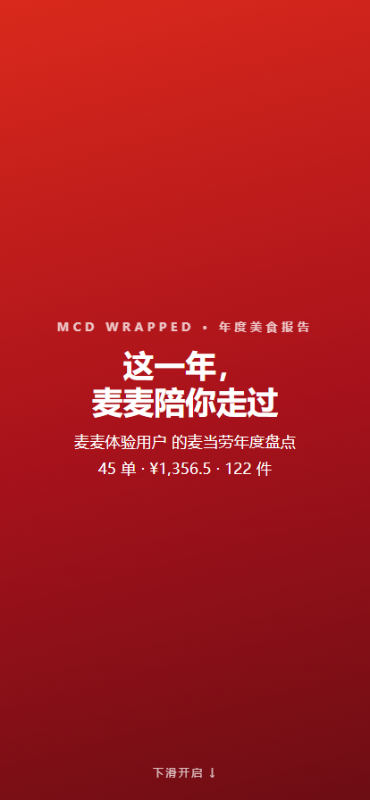
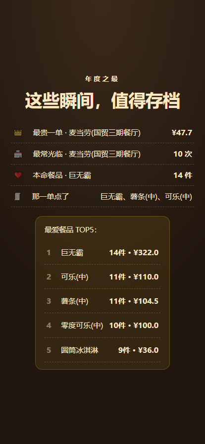
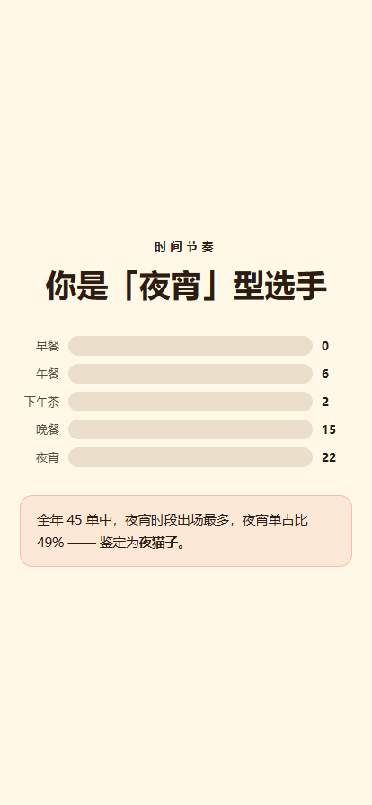
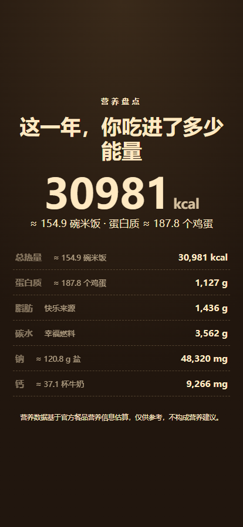
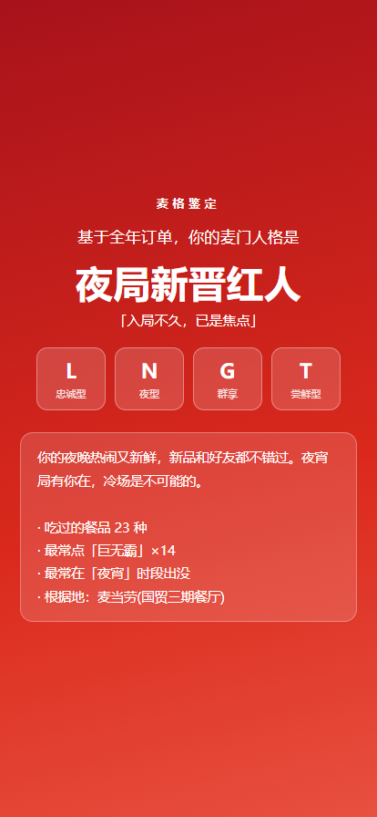
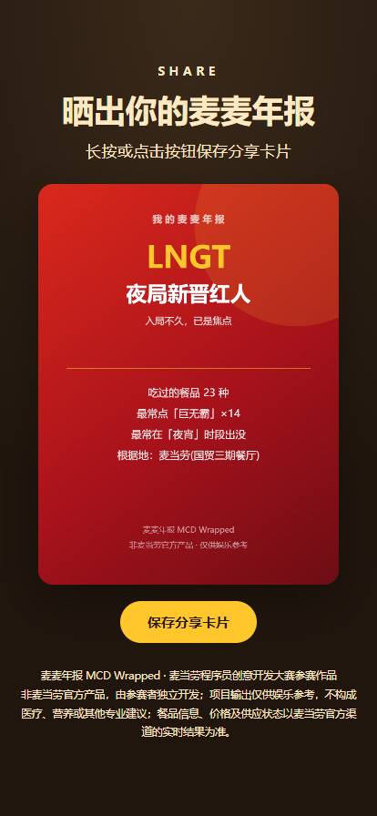

# 🍔 麦麦年报 MCD Wrapped

> **你的麦当劳年度美食报告** —— 一键把全年订单变成一份值得晒的交互式年报，顺便测测你的「麦格」。

[](https://github.com/M-China/mcd-developer-innovation-challenge)
[](https://github.com/M-China/mcd-mcp-server)
[](https://www.python.org/)
[](LICENSE)
[](src/)

**非麦当劳官方产品**，由参赛者独立开发。项目输出仅供娱乐参考，不构成医疗、营养或其他专业建议；餐品信息、价格及供应状态以麦当劳官方渠道的实时结果为准。

---

## ✨ 这是什么

基于麦当劳中国官方 MCP 能力开发的 WorkBuddy Skill：拉取你的订单、积分、商城兑换与抽奖记录，生成一份 **Spotify Wrapped 风格的可交互 HTML 年度报告**，并鉴定你的原创「麦格」人格，一键导出分享卡片。

45 单、¥1,356.5、114 件——你这一年的麦门故事，值得被认真复盘一次。

## 📸 报告长这样

| 封面 | 年度之最 | 时间节奏 |
|---|---|---|
|  |  |  |

| 营养盘点 | 麦格人格 | 分享卡片 |
|---|---|---|
|  |  |  |

想直接看效果？打开 [`examples/demo-report.html`](examples/demo-report.html)（示例数据，无需 Token）。

## 🎯 功能亮点

- **📊 交互式 HTML 年报**：全屏翻页 + 滚动动画 + 数字滚动，移动端优先，单文件离线可看，分享不失效
- **👑 年度之最**：最贵一单、最常光临门店、本命餐品 TOP5，全部来自你的真实订单
- **🕐 时间节奏**：早/午/下午茶/晚/夜宵五时段分布，鉴定你是晨型还是夜型
- **🥗 营养盘点**：全年热量/蛋白/脂肪/碳水/钠/钙汇总，附「≈ N 碗米饭」趣味换算
- **💎 麦门资产**：积分获得/消耗/过期、商城兑换记录、抽奖战绩全汇总
- **🧬 麦格人格（原创）**：四维模型（探索↔忠诚 / 晨型↔夜型 / 独食↔群享 / 尝鲜↔守旧）16 型解读
- **🖼️ 分享卡片**：一键导出 PNG，朋友圈晒图专用（页内 canvas 生成，无第三方服务）
- **🎭 Demo 模式**：没有 Token 也能用示例数据完整体验，README 截图全部来自该模式

## 🚀 快速开始

### 环境要求

- Python 3.10+，**零第三方依赖**（纯标准库）
- 一个麦当劳 MCP Token（[免费申请](https://open.mcd.cn/mcp)，手机号登录即可）

### 30 秒体验 Demo（无需 Token）

```bash
git clone https://github.com/Hxy1992/mcd-annual-report.git
cd mcd-annual-report
python -m src.cli --demo
# 打开 output/mcd-annual-report.html，你的示例年报就做好了
```

### 生成你的真实年报

```bash
# 1. 设置 Token（绝不写入任何文件，只从环境变量读取）
export MCD_MCP_TOKEN="你的Token"        # Windows PowerShell: $env:MCD_MCP_TOKEN="你的Token"

# 2. 运行
python -m src.cli                       # 生成 output/mcd-annual-report.html

# 3. 可选：导出 SVG 分享卡片
python -m src.cli --card output/share-card.svg
```

在 MCP Client 中接入麦当劳 MCP 的配置见 [`mcp-config.example.json`](mcp-config.example.json)。

## 🧑‍🤝‍🧑 目标用户

- **麦门信徒**：想复盘自己一年麦当劳消费的人（数据越丰富，报告越精彩）
- **选择困难症**：想用数据面对自己「到底吃了多少热量」的人
- **积分囤积症**：想知道积分花去哪、抽奖值不值的人
- **程序员围观群众**：想 30 秒看到成品再决定 Star 的人 😉

## 🏗️ 技术架构

```
mcd-annual-report/
├── SKILL.md                  # WorkBuddy Skill 描述（触发词/流程/合规约束）
├── src/
│   ├── mcp_client.py         # MCP 客户端：Streamable HTTP + Bearer + 限流退避
│   ├── aggregator.py         # 数据聚合：多候选字段解析，规范化为稳定结构
│   ├── analyzer.py           # 年报计算引擎：统计/年度之最/月度/营养
│   ├── persona.py            # 麦格人格：四维模型 + 16 型原创文案
│   ├── report_html.py        # 单文件 HTML 年报生成（内联 CSS/JS）
│   ├── card.py               # SVG 分享卡片
│   ├── demo_data.py          # 示例数据（固定种子，可复现）
│   └── cli.py                # 命令行入口（--demo / --mock / 真实模式）
├── templates/                # 报表 CSS/JS 模板（构建时内联）
└── tests/                    # 21 个离线测试，无需 Token 全绿
```

**设计原则**

1. **只读优先**：全程只调用只读工具（订单/积分/商城/抽奖/营养），从设计上杜绝误下单，合规零风险
2. **不缓存不伪造**：所有数据实时来自官方 MCP 返回；解析失败降级为空值并明示
3. **零依赖**：纯 Python 标准库，WorkBuddy 里直接跑；报表不依赖 CDN，离线可看
4. **防御式解析**：官方文档未给字段级 schema，聚合层对每个字段做多候选名兼容（camelCase/snake_case/嵌套包裹）

## 🔌 使用的麦当劳 MCP 工具

| 工具 | 用途 |
|---|---|
| `order-list` | 历史点餐订单（年报主体数据） |
| `mall-order-list` / `mall-order-detail` | 积分商城兑换记录 |
| `query-my-account` | 积分账户（可用/累计/消耗/即将过期） |
| `query-my-prizes` / `query-lottery-info` | 抽奖活动与中奖记录 |
| `list-nutrition-foods` | 餐品营养表（匹配订单餐品做营养汇总） |
| `now-time-info` | 当前时间（数据时效基准） |

详见 [MCP_INTEGRATION.md](MCP_INTEGRATION.md)。

## 🔐 安全与合规

- Token 只从环境变量 `MCD_MCP_TOKEN` 读取，**示例配置仅 `${MCD_MCP_TOKEN}` 占位符**，仓库内无任何真实凭证
- 不使用麦当劳官方 Logo/商标素材，视觉均为原创配色
- 全只读调用，无任何写操作（不下单、不领券、不抽奖）
- 报告页脚常驻免责声明；营养数据仅趣味参考，不构成专业建议
- 限流友好：串行调用 + 429 指数退避，远低于 600 次/分钟额度

## 🧪 测试

```bash
python -m unittest discover -s tests -v   # 21 个用例，全部离线可跑
```

## 🏆 赛事信息

本项目是[麦当劳程序员创意开发大赛](https://github.com/M-China/mcd-developer-innovation-challenge)参赛作品，使用 [WorkBuddy](https://www.workbuddy.cn/) 开发（官方合作伙伴，见 [workbuddy.md](workbuddy.md)）。参赛声明见 [CONTEST_DECLARATION.md](CONTEST_DECLARATION.md)（官方原文件，未做任何改动）。

## 📄 License

[MIT](LICENSE)

---

_用代码复盘热爱，用数据致敬麦门。🍟_
